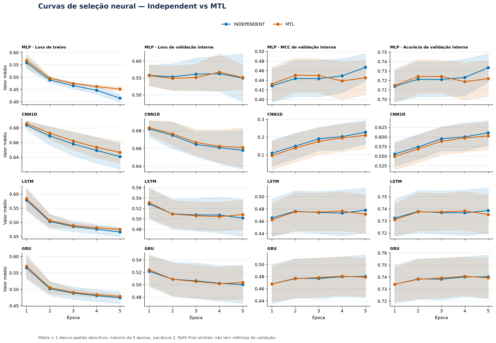
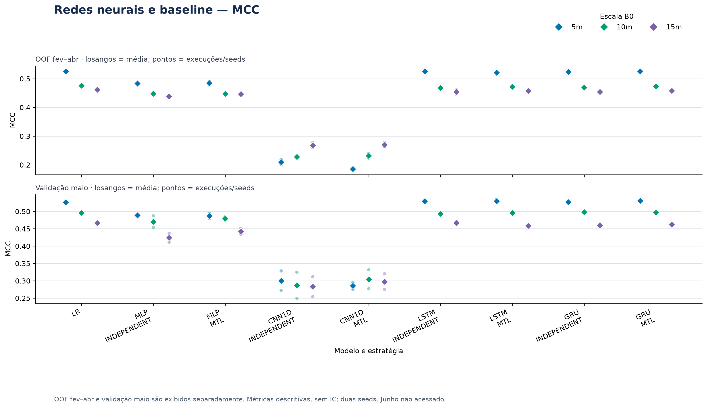
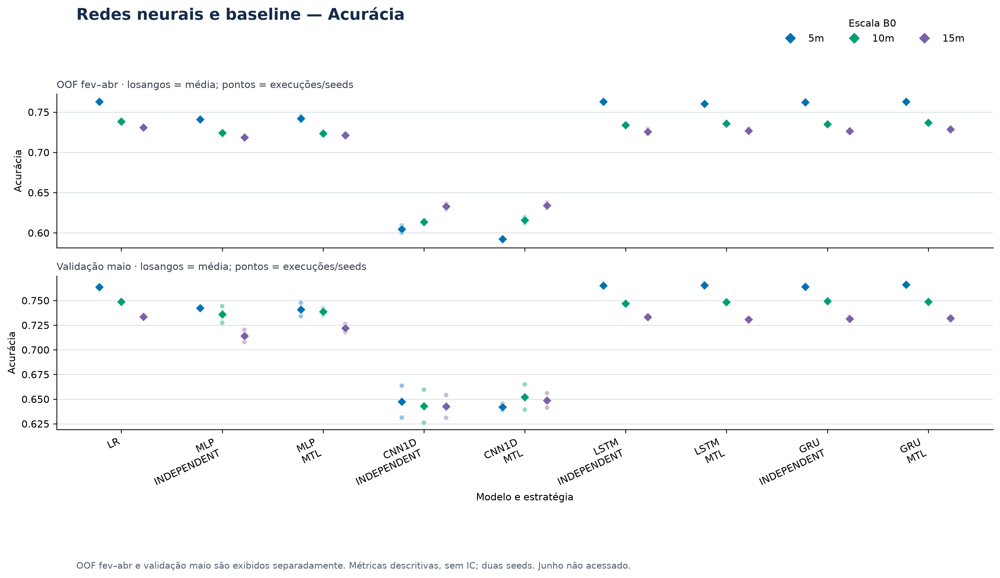
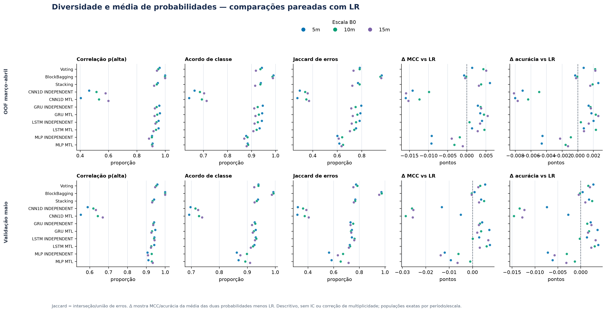

# Stage 12.1 — Training and performance figures

## Scope and data boundary

This diagnostic uses the 16 refit runs for MLP, CNN1D, LSTM, and GRU, with
Independent and MTL strategies and seeds 42/43. It uses Jan–Apr walk-forward
OOF and May development validation metrics only. June was not accessed. No
prediction rows or checkpoints were copied into this repository; the versioned
history export contains training/validation metrics and source hashes only.

All neural runs used an RTX 5060 Ti, FP32, batch size 256, at most five epochs,
patience two, and refit after early stopping. The figures separate early-stop
selection histories from full-block refit: refit has no validation metric and
must not be plotted as if it did.

## Figures









The two-seed markers are shown individually; diamonds show their mean. The
training curve shading is descriptive ±1 standard deviation across
fold/seed/scale records, not a confidence interval. Neural OOF in these figures
includes February–April, while the Stage 12 ensemble figures restrict OOF to
March–April to include Stacking. Do not compare those OOF points as if they
shared the same sample population. Existing Stage 12 ensemble figures report
MCC and accuracy on the exact common method population:

- [Stage 12 ensemble MCC](../../../figures/stage12-mcc-2026-11-23.png)
- [Stage 12 ensemble accuracy](../../../figures/stage12-accuracy-2026-11-23.png)

The complementarity figure compares neural architecture/strategy seed means
and the three Stage 12 ensembles with Logistic Regression on exact shared keys
and `y_true`, separately for March–April OOF and May. The CSV also retains
individual seed runs and the eight Stage 12 seed ensembles. Its Δ values are
the MCC or accuracy of a two-model mean-probability prediction minus the LR
score.

## Descriptive findings

- The Logistic Regression reference has MCC 0.5259 / 0.4763 / 0.4619 and
  accuracy 0.7630 / 0.7382 / 0.7308 on OOF February–April for B0 5/10/15m.
- In May, the strongest neural result depends on scale: GRU MTL at 5m (MCC
  0.5310; accuracy 0.7660), GRU Independent at 10m (0.4981; 0.7493), and
  LSTM Independent at 15m (0.4666; 0.7332). These are descriptive maxima among
  the two-seed neural runs, not confirmatory winners.
- Linear LR is competitive with the best neural results on several
  scale-period cells. This does not isolate model architecture: LR consumes
  row-level engineered features, while neural models consume 60-minute causal
  windows with missing-candle masks. Feature representation and optimization
  therefore differ as well as model class.
- Pooled selection curves show validation loss flattening around epochs 3–4,
  while training loss continues to fall through epoch 4 and rises slightly at
  epoch 5. Of the 64 run-fold selection decisions, 46 selected epoch 4 or 5.
  This makes the five-epoch cap a plausible restriction for some fits, but the
  aggregate curves do not prove undertraining. CNN1D validation MCC remains
  substantially below LR in these runs; longer training alone cannot be
  assumed to fix that gap.
- Only two seeds were evaluated. The plot has no confidence intervals and is
  not a significance test. No claim of superiority or transfer benefit is
  supported by these figures.
- Pairwise summary covers 28 prediction sources (16 neural seed runs, eight
  seed ensembles, LR, Voting, Block Bagging, and Stacking) and 3,321
  method-pair × scale × period rows. LR–Block Bagging probability correlations range from 0.9982 to 0.9998
  across the displayed OOF/May scales, with very high prediction agreement;
  this indicates little additional diversity from this bagging configuration.
  LR correlations with Voting are roughly 0.94–0.96 and with Stacking 0.92–0.95.
  The error Jaccard remains substantial, so disagreement does not imply
  complementary corrections. Mean-probability MCC/accuracy gains are small and
  change by scale and period; these descriptive pair sweeps have no confidence
  intervals or multiplicity correction.

## Reproduction

Run the export on the Linux experiment host, then render from the aggregate
history and the committed Stage 11 metric table. Use a new output directory and
summary path; commands refuse to overwrite existing files.

```bash
python scripts/export_stage11_histories.py \
  --results-root /home/ginfolab/EnsembleLearning/results \
  --output-csv reports/stage12/diagnostics/training_history.csv \
  --manifest reports/stage12/diagnostics/training_history_manifest.json

python scripts/plot_stage12_diagnostics.py \
  --history-csv reports/stage12/diagnostics/training_history.csv \
  --metrics-csv reports/stage12/refit-2026-11-23/metrics_by_run_fold_scale.csv \
  --source-manifest reports/stage12/refit-2026-11-23/manifest.json \
  --output-dir figures/stage12-diagnostics-<RUN_ID> \
  --summary-output reports/stage12/diagnostics/neural_metrics_summary_<RUN_ID>.csv

python scripts/summarize_stage12_complementarity.py \
  --results-root /home/ginfolab/EnsembleLearning/results \
  --output-csv reports/stage12/diagnostics/complementarity_<RUN_ID>.csv \
  --manifest reports/stage12/diagnostics/complementarity_manifest_<RUN_ID>.json

python scripts/plot_stage12_complementarity.py \
  --summary-csv reports/stage12/diagnostics/complementarity_<RUN_ID>.csv \
  --output figures/stage12-diagnostics-<RUN_ID>/complementarity
```

The checked-in files were rendered from the history export described in
`training_history_manifest.json`. The figure manifest records input and figure
hashes, period labels, and the holdout boundary.

## Feature-group ablation protocol

The current 21 input features are now assigned exhaustively to five
non-overlapping groups: returns (5), candle/price shape (4), volatility (4),
close-versus-SMA trend (4), and volume/activity (4). The definitions are
explicit in `scripts/run_feature_group_ablation.py`; any newly introduced
`x_` feature causes the script to stop until the taxonomy is updated.

The reproducible screen runs the full Logistic Regression baseline, each group
alone, and the full set with one group removed. All variants use the existing
expanding folds, preprocessing fit within each training fold, MCC at the fixed
0.5 threshold, and a checked identical anchor population. Each run stores the
usual predictions, metrics, source hash, and immutable result manifest. Example
command on the Linux experiment host:

```bash
python scripts/run_feature_group_ablation.py \
  --snapshot data/processed/win_2026_sequence_jan_may_v1.csv \
  --results-root results \
  --report-dir reports/stage12/feature-ablation-<RUN_ID> \
  --seed 42
```

This protocol is implemented but **has not been run**: the current Windows
checkout cannot establish SSH to the Linux host because no `ginfolab-maquinario`
host alias/private key is configured. Do not describe feature contributions as
measured until the run completes. “Only group” is a sufficiency screen;
“without group” is a conditional ablation, not causal feature importance.

## Audit status and remaining evidence

- The prior scripts and reports verify exact common keys and labels for their
  stored model comparisons. The current complementarity CSV contains aggregate
  statistics only; it cannot support new paired confidence intervals or a
  correction for the full 3,321-row exploratory pair sweep.
- Existing Stage 12 bootstrap contrasts are paired by session, but their
  intervals were reported without family-wise multiplicity correction. Keep
  all current findings exploratory; a future confirmatory family needs
  pre-specified contrasts and multiplicity control. A max-T implementation is
  now available below but has not been run on the Linux predictions.
- The metrics tables use different input representations: Logistic Regression
  fits current-row engineered features while neural networks process a causal
  60-minute tensor and missingness mask. Exact anchor equality controls the
  evaluation population, but does not isolate architecture effects.
- During the ablation eligibility test, the current pandas datetime dtype used
  microsecond integer units while `build_causal_windows` subtracted
  nanoseconds. This caused valid synthetic windows to be missed. The conversion
  now forces `datetime64[ns]`, with a regression test for microsecond timestamps.
  Historical Linux run impact is unknown until its pandas version/datetime units
  are checked; do not retroactively invalidate or endorse those runs based only
  on this Windows reproduction.
- The neural history table contains selection-phase epoch records, not epoch
  trajectories for the full-block refit. It supports a diagnosis of the
  five-epoch cap as a possible restriction (46/64 fold decisions selected
  epoch 4 or 5), but not a proof of underfitting or overfitting.
- No per-regime performance or PCGrad run has been produced. The current
  prediction aggregate does not include a frozen market-regime definition;
  adding one requires causal, training-only thresholds and a new manifest.

## Statistical comparison implementation

Added `scripts/paired_session_max_t.py` for an exact-key paired comparison of
per-method prediction Parquets. It calculates MCC and accuracy differences and
simultaneous 95% max-T bootstrap intervals, resampling whole session dates so
all contracts on a sampled date remain together. The max-T family includes all
pairwise methods and both metrics within each period × scale; Stacking's missing
first OOF fold is handled by reporting the exact March–April common population
separately. The script rejects June, duplicate keys, invalid probabilities and
label disagreement, and writes only aggregate rows plus input hashes.

This analysis **has not been run on the Linux predictions** because the current
checkout cannot establish authenticated SSH. It is an implemented method, not
new statistical evidence. Example after restoring the approved host/key setup:

```bash
python scripts/paired_session_max_t.py \
  --prediction LogisticRegression=/home/ginfolab/EnsembleLearning/results/EXP_STAGE11_PAIR_CLASSICAL_42/predictions.parquet \
  --prediction Voting=/home/ginfolab/EnsembleLearning/results/EXP_STAGE12_AVERAGING_MEMBERAUDIT_20261123/predictions.parquet \
  --prediction BlockBagging=/home/ginfolab/EnsembleLearning/results/EXP_STAGE12_BLOCKBAG_LOGREG_B5_M10_V2_20261123/predictions.parquet \
  --prediction "Stacking=${STACKING_PREDICTIONS}" \
  --output-csv reports/stage12/diagnostics/paired_max_t_<RUN_ID>.csv \
  --manifest reports/stage12/diagnostics/paired_max_t_manifest_<RUN_ID>.json \
  --iterations 5000 --seed 42
```

The path of the Stacking run must be confirmed against its actual manifest
before execution; never guess a run path. Intervals remain exploratory unless
the model family/contrasts and protocol have been frozen in advance.

See [`docs/experimental-budget-stage12.1.md`](../../../docs/experimental-budget-stage12.1.md)
for the staged GPU budget and [`docs/stage13-external-benchmarks.md`](../../../docs/stage13-external-benchmarks.md)
for the external-method reproduction gates. June remains unopened.
