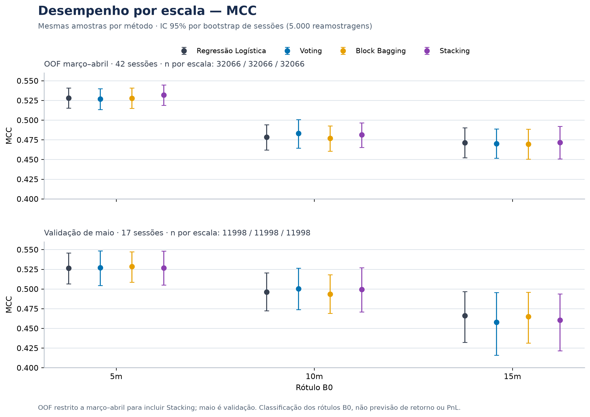
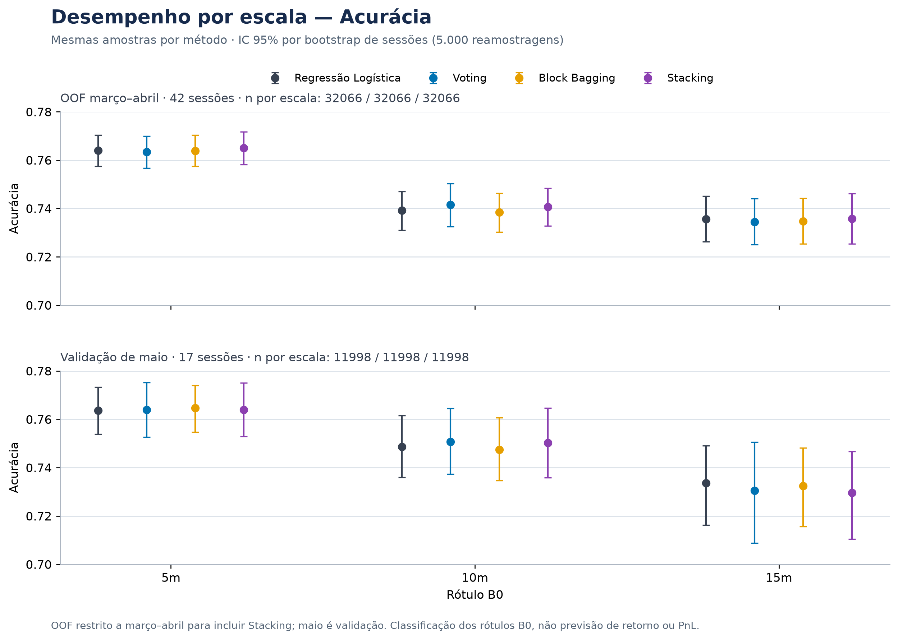

# MCC and accuracy figures — Stage 12

The figures compare Logistic Regression, Voting, Block Bagging, and Stacking
using identical sample keys and `y_true` within each period and B0 scale.
OOF is restricted to March–April (folds 02–03), so it includes the stacking
population; May is the separate development validation period. June was not
accessed.

Each point is the observed metric, with a 95% percentile interval from 5,000
session-level bootstrap resamples. OOF has 42 sessions and 32,066 samples per
scale; May has 17 sessions and 11,998 samples per scale. Intervals describe
uncertainty within each method and are not adjusted for multiple comparisons.
Visual overlap or non-overlap alone is not a paired significance test.

## Figures





PNG files are for viewing; PDF files are vector exports. `manifest.json` records
the source prediction hashes, exact key and class checks, bootstrap settings,
and holdout status. Only aggregate metrics are versioned; raw predictions stay
on the Linux experiment host.

## Reproduction

On the Linux experiment host, after installing the plotting extra if needed:

```bash
RUN_ID="$(date -u +%Y%m%dT%H%M%SZ)"
python scripts/summarize_stage12_common_metrics.py \
  --results-root /home/ginfolab/EnsembleLearning/results \
  --output-csv reports/stage12/paired-metrics-2026-11-23/metrics_by_method_period_scale_${RUN_ID}.csv \
  --iterations 5000 --seed 42

python scripts/plot_stage12_metrics.py \
  --summary-csv reports/stage12/paired-metrics-2026-11-23/metrics_by_method_period_scale_${RUN_ID}.csv \
  --output-dir figures/stage12-${RUN_ID}
```

Install `matplotlib` through `python -m pip install -e ".[plots]"` before
rendering if it is not already present. The scripts refuse to overwrite
existing result files; when rerunning, use a new summary filename and a new
figure output directory in the commands above.
